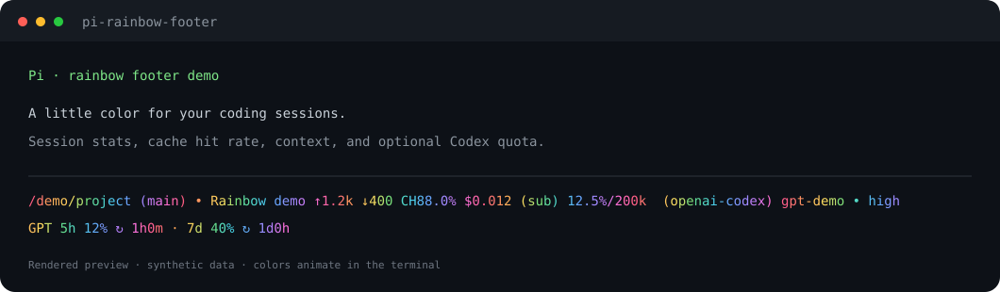

# Pi Rainbow Footer 🌈

An animated rainbow footer for [Pi coding agent](https://github.com/earendil-works/pi), with session stats, cache hit rate, context usage, and optional Codex quota information.

[中文](README.md) · MIT · Tested with Pi **0.85.1** / Node.js **22.19+**



This preview uses the extension's actual renderer with synthetic data. Appearance depends on your terminal font and true-color support.

## Install

```bash
pi install git:github.com/zgj-119/pi-rainbow-footer
```

Restart Pi or run `/reload` in an open interactive session. To try it temporarily:

```bash
pi -e git:github.com/zgj-119/pi-rainbow-footer
```

The extension runs in Pi's interactive terminal mode and uses Pi-provided dependencies without a build step. Pi 0.85.1 is the tested version; older `@mariozechner/*` packages are outside the supported range. If you already have a manually installed `rainbow-footer.ts`, keep only one loading method. Disable other extensions that replace the footer.

## What it shows

| Item | Meaning |
| --- | --- |
| First line | Directory, Git branch, session name, stats, model, thinking level |
| Second line | Codex quota when supported response headers are available; otherwise `....` |
| `↑` / `↓` | Cumulative input / output tokens from assistant messages |
| `W` | Cumulative cache-write tokens |
| `CH` | Cache-read tokens / total prompt tokens for the latest assistant message |
| `$` / `(sub)` | Reported cumulative cost / OAuth subscription marker |
| `%/window` | Current context usage and context window size |

Quota percentages mean **used**, not remaining. Quota and reset durations are snapshots from the most recent `after_provider_response` event's `x-codex-*` headers. The extension makes no extra account requests. Without these headers, quota is unavailable. Cost depends on what the provider reports.

The animation updates locally every 180 ms. Usage totals include assistant messages; separately recorded tool, compaction, and branch-summary usage is not included.

## Customize and remove

Edit `RAINBOW` in `rainbow-footer.ts` to change the palette, or the `180` interval to change the refresh rate. Run `/reload` after editing.

```bash
pi remove git:github.com/zgj-119/pi-rainbow-footer
```

## Develop

```bash
git clone https://github.com/zgj-119/pi-rainbow-footer.git
cd pi-rainbow-footer
npm ci --ignore-scripts
npm run check
npm run preview
pi -e ./rainbow-footer.ts
```

Tests use mocked Pi contexts to check extension registration, stats, Unicode and narrow terminal widths, quota headers, and cleanup. The preview contains no real session or account data.

## License and attribution

[MIT](LICENSE). Some formatting and statistics code is adapted from Pi's official footer. See [NOTICE.md](NOTICE.md) for attribution. This is a community extension.
